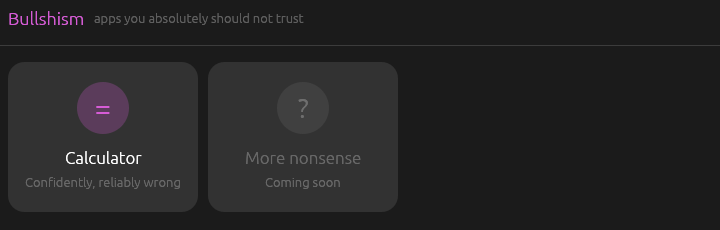
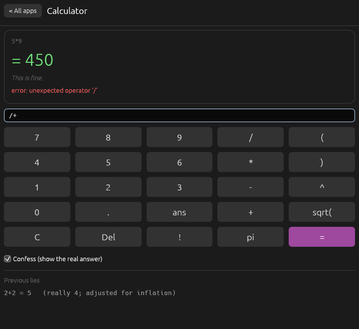

# Bullshism

**A launcher full of apps you absolutely should not trust.**

Open Bullshism and you get a launcher. Every bullshit app lives inside it, and
the first one is the calculator that is confidently, reliably, beautifully wrong.



The calculator is real, written in Rust. It parses your expression properly,
works out the correct answer, and then gives you a different one, always with total
confidence. Click the tile for buttons, or use it straight from the terminal:

```
$ bullshism 2+2
= 5 Mathematically certain.

$ bullshism "sqrt(16) * 10"
= 4.0 Peer reviewed by my cousin.
```

It is a joke. Please don't do your taxes with it.



## Features

- A launcher window with a tile for each app (Escape takes you back to it)
- A clickable calculator with a keypad, typing, a history of previous lies and a
  confess switch

- A full expression parser: `+ - * / % ^ !`, brackets, implicit multiplication (`2(3+4)`, `2pi`)
- Functions: `sqrt cbrt abs sin cos tan asin acos atan ln log exp floor ceil round`
- Constants: `pi e tau phi`, plus `ans` for the last answer it gave you (so lies compound)
- Ten ways to be wrong: off-by-one, flipped sign, swapped digits, "adjusted for inflation",
  a stray extra digit, a wandering decimal point, reversed digits, a "nicer" round number,
  "close enough", and simply swapping in a funnier number
- A guarantee: it never tells the truth, and the tests check that
- Interactive mode with colour, or one-shot mode for scripts
- `--confess` shows the real answer and how it was ruined
- `--seed N` makes the lies repeatable
- The terminal side has no dependencies; the launcher uses [egui](https://github.com/emilk/egui)

## Build

You need Rust 1.95 or newer (the launcher's egui needs it).

```sh
git clone https://github.com/MysticYewXd/Bullshism.git
cd Bullshism
cargo build --release
./target/release/bullshism
```

To put it on your PATH and in your app menu (Linux):

```sh
cargo install --path .
install -Dm644 assets/bullshism.desktop ~/.local/share/applications/bullshism.desktop
```

After that, Bullshism shows up in your app menu and opens the launcher.

## Usage

```
bullshism                     open the launcher (a window)
bullshism [OPTIONS] EXPR...   print one (wrong) answer and exit
bullshism --cli [OPTIONS]     start the calculator in the terminal

  -c, --confess     Also show the real answer and how it was ruined
  -s, --seed <N>    Use a fixed seed, so the same lies come out every time
      --cli         Stay in the terminal instead of opening the launcher
  -h, --help        Show help
  -V, --version     Show the version
```

With no arguments it opens the launcher. If there is no screen to open it on
(over SSH, say), it starts the interactive session in the terminal instead.
In the session, type `help`, `confess` to toggle confess mode, or `quit`
(Ctrl+D also works).

```
$ bullshism --cli
Bullshism - the calculator you can't trust. Type 'help' or 'quit'.
> 5!
= 121 Source: trust me bro.
> confess
confess mode on
> 2+3*4
= 140 No further questions.
  (really 14; decimal point wandered off)
```

The one thing it won't lie about is dividing by zero.

## Adding a new bullshit app

Each app is a type that implements `BullshitApp` (in `src/apps/mod.rs`): a name,
a tagline, a one-character icon and a `ui` function that draws it. Put it in
`src/apps/`, add it to `all()`, and the launcher gives it a tile.

## Tests

```sh
cargo test
```

## Licence

MIT, see [LICENSE](LICENSE).
